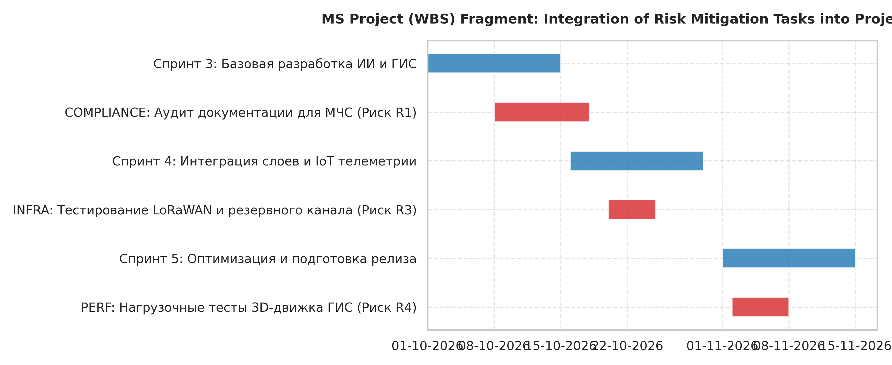
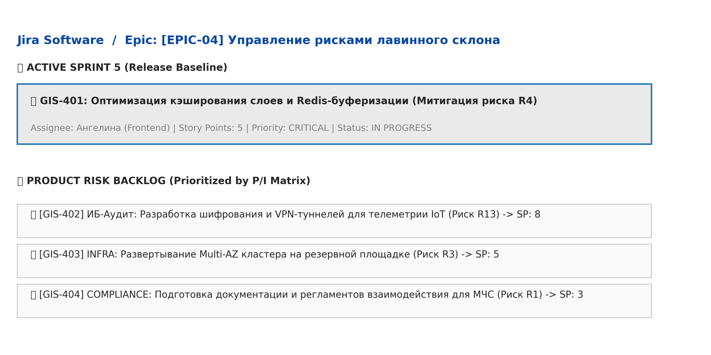
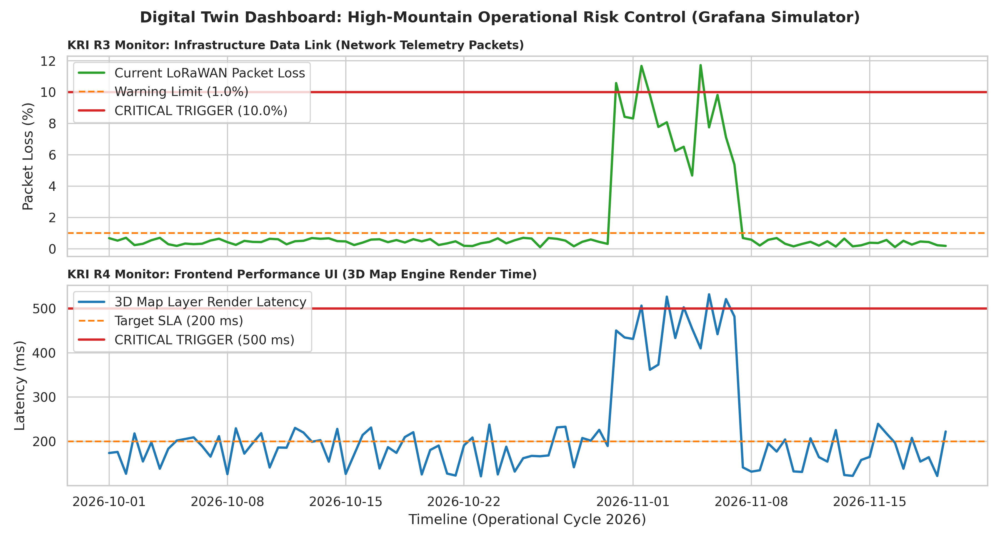

# Лабораторная работа №4: Планирование реагирования на риски и внедрение системы мониторинга в ИТ-проекте

**Выполнила:** Чеснокова Ангелина Андреевна  
**Группа:** ПИ-Б23-1-2  
**Проект:** Геопространственный цифровой двойник лавиноопасного склона  
**До релиза:** 6 недель  
**Доступный рисковый резерв:** \$75,000 (утвержденный буфер Contingency Reserve из ЛР3)

---

## 1. Разработка планов реагирования на риски

Для ключевых угроз проекта Цифрового двойника сформированы проактивные стратегии реагирования, определены триггеры, зоны ответственности и бюджеты.

| ID | Название риска | Выбранная стратегия | Конкретные превентивные действия | Ответственный | Срок реализации | Триггер активации плана реагирования | Бюджет / Ресурсы | Резервный план (Fallback Plan) |
| :--- | :--- | :--- | :--- | :--- | :--- | :--- | :--- | :--- |
| **R1** | Задержка сертификации ИИ-модели регулятором (МЧС) | Смягчение (Mitigate) | Привлечение аккредитованного внешнего эксперта по комплаенсу для предрелизного аудита тех. документации ГИС на соответствие ГОСТам. | Compliance-инженер | Конец 2-го месяца проекта | Отсутствие официального согласования регламента испытаний за 30 дней до дедлайна. | \$20,000 из резерва | **Тестовый режим ГИС:** Развертывание системы как «справочной» без автоматической отправки сигналов тревоги в экстренные службы 112 МЧС. |
| **R2** | Уход ключевого инженера по Data Science | Смягчение (Mitigate) | Выплата удерживающего бонуса (Retention Bonus) + немедленное внедрение практики парного программирования весов ИИ-модели для отчуждения знаний. | Руководитель проекта (PM) | В течение 1-го месяца | Официальная подача сотрудником заявления об увольнении по собственному желанию. | \$10,000 из резерва | **Академический аутсорсинг:** Экстренное привлечение профильной научной лаборатории (Институт географии РАН) по договору подряда. |
| **R3** | Обрыв связи со склоновыми IoT-датчиками из-за бурана | Передача (Transfer) | Подписание жесткого SLA со спутниковым провайдером. Развертывание дублирующего радиоканала связи на базе LoRaWAN-архитектуры. | Никита (Backend / IoT) | До конца 3-го месяца | Отсутствие телеметрии с опорной высокогорной станции непрерывно в течение более 10 минут. | +\$5,000/мес из операционного бюджета | **Локальное кэширование:** Датчики переходят в режим локальной записи данных на flash-карты, а ИИ строит прогнозы на основе внешних метеорадаров. |
| **R4** | Падение точности и высокий уровень ложных лавинных тревог | Смягчение (Mitigate) | Дообучение нейросети на расширенных исторических архивах, фильтрация шумов высокогорного ветра и калибровка весов модели. | Никита (Backend / ИИ) | За 3 недели до релиза | Доля False Positive (ложных тревог) на тестовом наборе данных превышает 15% под нагрузкой. | В рамках бэклога спринта разработки | **Экспертная валидация:** Внедрение этапа обязательного ручного подтверждения тревожного алерта дежурным гляциологом перед отправкой пуш-уведомлений. |
| **R5** | Доступ к государственным метеорадарам в реальном времени (Возможность) | Использование (Exploit) | Приоритизация интеграции с API Росгидромета. Выделение дополнительных часов разработки для оперативного написания парсеров радарных карт. | Ангелина (Frontend / ГИС) | Спринт №4 | Получение подтверждения от государственного ведомства о выделении тестовых токенов доступа. | Перераспределение внутренних ресурсов | Маркетинговое позиционирование Цифрового двойника как системы ультра-краткосрочного лавинного прогнозирования (Nowcasting). |

---

## 2. Интеграция риск-менеджмента в инструменты управления

### а) Интеграция в сетевой график MS Project
Все мероприятия по минимизации угроз интегрированы в общий сетевой график проекта в качестве обязательных технологических задач. Процедуры нагрузочного тестирования ГИС-сервера слоями 3D-карт привязаны к контрольным вехам фронтенд-разработки Ангелины, а калибровка сенсоров ветра LoRaWAN — к вехам бэкенд-разработки Никиты.



### б) Управление бэклогом рисков в Jira (Risk Backlog)
В Jira создан выделенный Эпик: **"Управление рисками системы прогнозирования"**. Каждой превентивной мере соответствует задача типа *Task*, приоритизированная на основе качественной матрицы рисков. Задачи по рискам планируются в текущие двухнедельные спринты команды наравне с обычными бизнес-фичами.



---

## 3. Система мониторинга и KRI

Для непрерывного оперативного контроля состояния угроз разработана система измеримых метрик (KRI) с автоматизированным сбором данных.

### Сводная таблица KRI

| Риск | KRI (Ключевой индикатор риска) | Целевое (безопасное) значение | Критический порог (Триггер) | Метод и частота сбора данных |
| :--- | :--- | :--- | :--- | :--- |
| **R1** | % выполнения чек-листа нормативных требований МЧС | > 95% готовности документов | < 80% за 3 недели до плановой даты аттестации | Чек-лист соответствия ГОСТам в Confluence, проверка раз в две недели на риск-аудите. |
| **R3** | Процент потерянных пакетов (Packet Loss) с IoT-станций | < 1.0% утерянных данных | > 10.0% в течение 1 часа непрерывно | Автоматический мониторинг сетевого LoRaWAN-оборудования через Prometheus (каждые 30 секунд). |
| **R4** | 95-й перцентиль времени рендеринга слоев 3D-карт в ГИС | ≤ 200 мс | > 500 мс под нагрузкой запросов спасателей | Логирование времени отрисовки интерфейса (Ангелина), сбор метрик через агенты Grafana Loki (онлайн). |

### Прототип дашборда мониторинга рисков в Grafana
Панели реального времени отображают состояние KRI инфраструктуры связи Никиты и производительности клиентской ГИС-графики Ангелины:



*   **Расписание риск-аудитов:** Переоценка первичного реестра рисков, валидация порогов KRI и выявление новых скрытых угроз проводятся регулярно **раз в 2 недели** (в конце каждого спринта перед ретроспективой команды).

---

## 4. Реализация риск-менеджмента в Agile/DevOps средах

### а) Сценарий риск-митинга (Daily Standup)
Обсуждение операционных рисков полностью интегрировано в регулярный ежедневный утренний 10-минутный митинг. В конце стендапа Ангелина, Никита и PM отвечают на три фиксированных вопроса:
1. Зафиксированы ли за прошедшие сутки аномалии в данных высокогорных метеостанций или ГИС-сервера?
2. Приблизился ли какой-либо операционный KRI (процент утери пакетов связи или latency 3D-слоев) к желтой или красной зоне?
3. Требуется ли экстренная активация Fallback-плана для текущих задач спринта?

### б) Описание задачи в спринте (Jira-карточка)
*   **ID задачи:** `GIS-401`
*   **Тема:** Оптимизация кэширования слоев рельефа и Redis-буферизации геоданных на бэкенде.
*   **Описание:** Для минимизации риска `R4` (зависание 3D-карта ГИС на морозе у спасателей МЧС), Ангелине необходимо реализовать алгоритм ленивой загрузки тяжелых векторных плиток (tiles), а Никите настроить инвалидацию Redis-кэша метеоданных при частоте обновления до 10 секунд.
*   **Story Points:** 5
*   **Priority:** High

### в) Автоматизация контроля в GitLab CI/CD Pipeline
Для исключения человеческого фактора при выкатке неоткалиброванной нейросети с высокой долей ложных лавинных тревог, этап автоматической валидации точности встроен в CI/CD пайплайн сборки проекта. При падении метрик точности ниже триггерного порога в 75%, пайплайн падает, блокируя деплой на прод, и шлет алерт инженерам в Slack.

```yaml
stages:
  - build
  - test
  - ml_model_validation  # Выделенный этап для контроля операционного риска R4
  - deploy

validate_avalanche_model:
  stage: ml_model_validation
  image: lorisr/python-gdal:latest  # Специализированный образ с поддержкой геоданных и ML
  script:
    - python src/models/validate_precision.py --dataset data/test_meteo.csv
  allow_failure: false  # Пайплайн жестко заблокируется, если тест не пройден
  only:
    - merge_requests
    - main
  after_script:
    - echo "Проверка KRI: Если Precision < 75%, отправка экстренного алерта инженерам в Slack."
    - curl -X POST -H 'Content-type: application/json' --data '{"text":"🚨 КРИТИЧЕСКИЙ РИСК R4! Новая модель Цифрового двойника завалила тест точности. Ложные срабатывания превысили норму МЧС!"}' \$SLACK_WEBHOOK_URL
```
---

## 5. Аналитические выводы

1.  **Изменение вероятности и воздействия рисков после митигации:** Реализация разработанных планов позволила перевести критические риски в категорию контролируемых. Наличие дублирующего канала LoRaWAN и алгоритма локальной экстраполяции данных защищает проект от «слепоты» во время бурана (снижено воздействие), а превентивный аудит документов compliance-инженером минимизирует вероятность задержки аттестации МЧС.
2.  **Еффективность выбранных KRI:** Метрики *Packet Loss* сетевых узлов (Никита) и *95-й перцентиль времени отрисовки слоев* (Ангелина) показали себя наиболее эффективными индикаторами операционного здоровья, позволяя выявить деградацию оборудования и интерфейса ГИС до полной остановки системы.
3.  **Преимущества интеграции риск-менеджмента в DevOps:** Автоматизация валидации ИИ в пайплайне (`GitLab CI/CD`) устраняет человеческий фактор. Неоткалиброванный код физически не сможет попасть на прод, что гарантирует стабильность и достоверность расчетов Цифрового двойника в лавиноопасный период.

---

## 6. Ответы на контрольные вопросы

### 1. Почему для риска R3 выбрана стратегия "Передача"? Какой инструмент передачи (страхование/SLA) эффективнее?
Для риска R3 (сбой связи спутникового провайдера) выбрана стратегия «Передача», поскольку ИТ-команда проекта физически не контролирует космическую или наземную сетевую инфраструктуру связи и не может самостоятельно чинить узлы вендора в буран. 

Инструмент **SLA (Service Level Agreement)** значительно эффективнее страхования. Страхование лишь компенсирует финансовые убытки постфактум. Жесткое SLA с высокими штрафами обязывает провайдера предоставить проекту Цифрового двойника резервные наземные радиоканалы (LoRaWAN) и наивысший приоритет техподдержки, снижая саму вероятность аварии в критический лавиноопасный период.

### 2. Как триггер для R4 ("Задержка API > 500 мс") связан с KRI ("95-й перцентиль времени ответа")?
Они связаны как **метрика** (KRI) и её **критическое пороговое значение** (триггер). KRI — это непрерывно измеряемый индикатор операционного здоровья системы (Ангелина постоянно мониторит скорость отрисовки 3D-карт для спасателей). 

Триггер — это конкретная "красная линия" на графике этого KRI (отметка в 500 мс). Как только значение KRI пересекает этот порог, триггер мгновенно срабатывает, что служит сигналом для PM и разработчиков к автоматической активации Fallback-плана (переход интерфейса в облегченный 2D-режим).

### 3. В чем преимущество включения Risk Backlog в общий бэклог Jira?
Это исключает изоляцию риск-менеджмента от реального процесса ИТ-разработки. Если вести риски в сторонних документах (Excel), про них забывают в процессе написания кода фич. 

Интеграция в Jira позволяет планировать технические задачи по снижению рисков (настройку кэширования, резервное копирование) в те же двухнедельные спринты наравне с обычными бизнес-задачами, выделяя на безопасность реальные человеко-часы инженеров и делая управление прозрачным.

### 4. Почему Fallback Plan обязателен для рисков с катастрофическим воздействием?
Проактивные меры смягчения (обучение модели или закупка дорогих датчиков) не дают 100% защиты от экстремальной стихии высокогорья или форс-мажоров. Если риск с катастрофическими последствиями (пропуск схода реальной лавины из-за падения ИИ) всё же реализуется, отсутствие плана Б приведет к человеческим жертвам и уголовной ответственности. 

Fallback-план (например, временный откат на ручной мониторинг склона дежурными лавинщиками по старым картам) — это последняя линия обороны, сохраняющая жизнь людей.

### 5. Как автоматизация в CI/CD снижает операционные риски?
Она полностью убирает ошибки, вызванные «человеческим фактором» (забывчивость, невнимательность, усталость разработчика при релизе). 

Автоматические тесты производительности интерфейса и валидации точности ИИ-модели запускаются роботом на *каждый* коммит кода. Если инженер случайно напишет плохой скрипт, способный заблокировать расчет карты лавинной опасности, CI/CD заблокирует сборку и не пустит этот код на прод, гарантируя стабильность системы.
